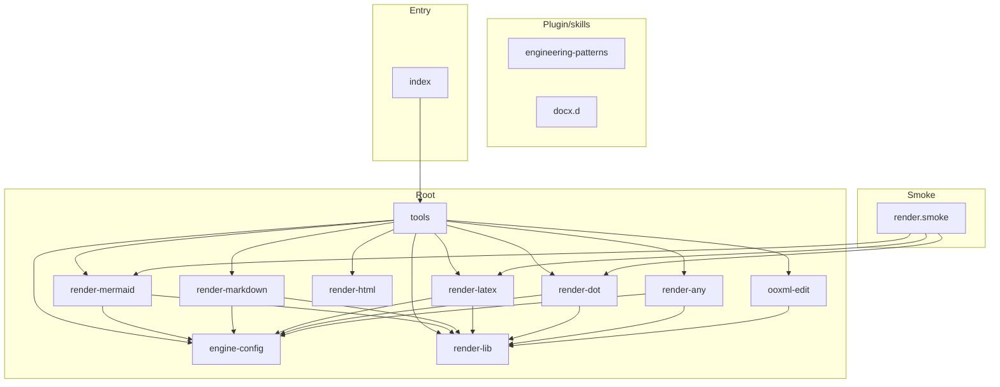

<!-- repo-map:no-verification -->
<!-- GENERATED FILE -- do not edit by hand.
     Regenerate with `repo-tools map`. -->

# scieng-mcp - Dependency Graph

**Version**: 1.0.6

This document provides a comprehensive dependency graph of all files, components, imports, functions, and variables in the codebase.

---

## Table of Contents

1. [Overview](#overview)
2. [Package Dependencies](#package-dependencies)
3. [Plugin/skills Dependencies](#plugin-skills-dependencies)
4. [Smoke Dependencies](#smoke-dependencies)
5. [Root Dependencies](#root-dependencies)
6. [Entry Dependencies](#entry-dependencies)
7. [Dependency Matrix](#dependency-matrix)
8. [Circular Dependency Analysis](#circular-dependency-analysis)
9. [Visual Dependency Graph](#visual-dependency-graph)
10. [Summary Statistics](#summary-statistics)

---

<a id="overview"></a>
## Overview

The codebase is organized into the following modules:

- **plugin/skills**: 2 files
- **smoke**: 1 file
- **root**: 10 files
- **entry**: 1 file

---

<a id="plugin-skills-dependencies"></a>

## Plugin/skills Dependencies

### `plugin/skills/scieng/engineering-patterns.ts` - ENGINEERING DOCX PATTERNS - TypeScript Reference

**External Dependencies:**
| Package | Import |
|---------|--------|
| `docx` | `Paragraph, TextRun, Table, TableRow, TableCell, Header, Footer, AlignmentType, HeadingLevel, BorderStyle, WidthType, PageNumber, ShadingType, VerticalAlign, TableOfContents, Bookmark, InternalHyperlink, ImageRun, StyleLevel` |

**Node.js Built-in Dependencies:**
| Module | Import |
|--------|--------|
| `fs` | `*` |

**Exports:**

---

### `plugin/skills/scieng/stubs/docx.d.ts` - Minimal ambient stub for the `docx` npm package so engineering-patterns.ts

**Exports:**
- Classes:

  ```text
  Paragraph, TextRun, Header, Footer, Table, TableRow, TableCell, TableOfContents, ImageRun, Bookmark,
  InternalHyperlink, StyleLevel
  ```

- Constants: `HeadingLevel`, `AlignmentType`, `WidthType`, `BorderStyle`, `PageNumber`, `ShadingType`, `VerticalAlign`

---

<a id="smoke-dependencies"></a>

## Smoke Dependencies

### `smoke/render.smoke.ts` - Live-API smoke test — NOT part of the `node --test` unit suite.

**Node.js Built-in Dependencies:**
| Module | Import |
|--------|--------|
| `fs` | `mkdtempSync, readFileSync, writeFileSync` |
| `os` | `tmpdir` |
| `path` | `join` |

**Internal Dependencies:**
| File | Imports | Type |
|------|---------|------|
| `../src/render-dot.ts` | `renderDotSource` | Import |
| `../src/render-mermaid.ts` | `renderMermaidSource` | Import |
| `../src/render-latex.ts` | `renderLatex` | Import |

---

<a id="root-dependencies"></a>

## Root Dependencies

### `src/engine-config.ts` - Returns the engine config that reads the assets from the folder beside the given module.

**External Dependencies:**
| Package | Import |
|---------|--------|
| `@danielsimonjr/sciengjs` | `SciengConfig` |

**Exports:**
- Functions: `bundledEngineConfig`, `engineConfig`

---

### `src/ooxml-edit.ts` - Decodes the XML entities of a text node. An unknown named entity, or a numeric reference that

**Node.js Built-in Dependencies:**
| Module | Import |
|--------|--------|
| `fs` | `readFileSync` |

**Internal Dependencies:**
| File | Imports | Type |
|------|---------|------|
| `./render-lib.ts` | `writeOutput` | Import |

**Exports:**
- Interfaces: `EditResult`
- Functions: `assertNoDoctype`, `replaceInRuns`, `applyEdits`

---

### `src/render-any.ts` - Renders any input type and output format that the sciengjs engine supports, and writes the bytes to disk.

**External Dependencies:**
| Package | Import |
|---------|--------|
| `@danielsimonjr/sciengjs` | `render, InputType, OutputFormat, RenderOptions` |

**Internal Dependencies:**
| File | Imports | Type |
|------|---------|------|
| `./render-lib.ts` | `writeOutput` | Import |
| `./engine-config.ts` | `engineConfig` | Import |

**Exports:**
- Interfaces: `AnyRenderResult`
- Functions: `renderPlotSvg`, `renderAny`

---

### `src/render-dot.ts` - Renders DOT graph sources through the sciengjs engine and writes the image to disk.

**External Dependencies:**
| Package | Import |
|---------|--------|
| `@danielsimonjr/sciengjs` | `render` |

**Internal Dependencies:**
| File | Imports | Type |
|------|---------|------|
| `./render-lib.ts` | `writeOutput` | Import |
| `./engine-config.ts` | `engineConfig` | Import |

**Exports:**
- Functions: `renderDotSource`

---

### `src/render-html.ts` - Builds one HTML page from the blocks, in the order given.

**Exports:**
- Interfaces: `HtmlBlock`
- Types: `BlockType`
- Functions: `buildHtml`, `resolveStaticBlocks`

---

### `src/render-latex.ts` - Splits a LaTeX source into blocks.

**External Dependencies:**
| Package | Import |
|---------|--------|
| `@danielsimonjr/sciengjs` | `render, RenderError` |

**Internal Dependencies:**
| File | Imports | Type |
|------|---------|------|
| `./render-lib.ts` | `readInput, writeOutput` | Import |
| `./engine-config.ts` | `engineConfig` | Import |

**Exports:**
- Interfaces: `Block`, `LatexFailure`
- Types: `LatexFormat`
- Functions: `extractBlocks`, `combineSvgs`, `renderLatexSource`, `renderLatex`
- Constants: `LATEX_FORMATS`

---

### `src/render-lib.ts` - Sends an HTTP request and returns the response text.

**Node.js Built-in Dependencies:**
| Module | Import |
|--------|--------|
| `fs` | `readFileSync, writeFileSync, renameSync, statSync, mkdirSync, rmSync` |
| `crypto` | `randomUUID` |
| `path` | `dirname, join, basename, extname` |

**Exports:**
- Interfaces: `HttpOptions`
- Types: `FetchLike`
- Functions: `httpText`, `readInput`, `readInputBytes`, `deriveOutputPath`, `writeOutput`, `mapLimit`
- Constants: `RETRY_AFTER_CAP_MS`

---

### `src/render-markdown.ts` - Returns the path of an asset in the folder dir. Throws when the name is empty, holds a separator, "..", ":" or NUL,

**External Dependencies:**
| Package | Import |
|---------|--------|
| `@danielsimonjr/sciengjs` | `render, RenderError` |

**Node.js Built-in Dependencies:**
| Module | Import |
|--------|--------|
| `fs` | `existsSync, linkSync, mkdirSync, unlinkSync, writeFileSync` |
| `crypto` | `randomUUID` |
| `path` | `basename, dirname, extname, isAbsolute, join` |

**Internal Dependencies:**
| File | Imports | Type |
|------|---------|------|
| `./render-lib.ts` | `readInput` | Import |
| `./engine-config.ts` | `engineConfig` | Import |

**Exports:**
- Interfaces: `MarkdownResult`, `HtmlToMarkdownArgs`, `MarkdownFs`
- Functions: `assetFilePath`, `uniquePath`, `rewriteImageLinks`, `htmlToMarkdownFile`

---

### `src/render-mermaid.ts` - Draws a Mermaid source to an SVG, PNG or PDF file and returns the written byte count and any engine warnings.

**External Dependencies:**
| Package | Import |
|---------|--------|
| `@danielsimonjr/sciengjs` | `render` |

**Internal Dependencies:**
| File | Imports | Type |
|------|---------|------|
| `./render-lib.ts` | `writeOutput` | Import |
| `./engine-config.ts` | `engineConfig` | Import |

**Exports:**
- Types: `MermaidFormat`
- Functions: `renderMermaidSource`
- Constants: `MERMAID_FORMATS`

---

### `src/tools.ts` - Runs the handler of the named tool, and returns the MCP result.

**External Dependencies:**
| Package | Import |
|---------|--------|
| `@modelcontextprotocol/server` | `Tool` |
| `zod` | `z` |
| `@danielsimonjr/sciengjs` | `RENDER_ERROR_CODES, INPUT_TYPES, OUTPUT_FORMATS, BINARY_INPUT_TYPES, loadConfig, capabilities` |

**Internal Dependencies:**
| File | Imports | Type |
|------|---------|------|
| `./render-lib.ts` | `readInput, readInputBytes, deriveOutputPath, writeOutput` | Import |
| `./render-mermaid.ts` | `renderMermaidSource, MERMAID_FORMATS` | Import |
| `./render-any.ts` | `renderAny, renderPlotSvg` | Import |
| `./render-dot.ts` | `renderDotSource` | Import |
| `./engine-config.ts` | `engineConfig` | Import |
| `./render-latex.ts` | `renderLatexSource, LATEX_FORMATS` | Import |
| `./render-html.ts` | `buildHtml, resolveStaticBlocks, HtmlBlock` | Import |
| `./ooxml-edit.ts` | `applyEdits` | Import |
| `./render-markdown.ts` | `htmlToMarkdownFile` | Import |

**Exports:**
- Interfaces: `ToolResult`
- Types: `ToolHandler`
- Functions: `dispatchTool`, `makeHandlers`
- Constants: `TOOLS`

---

<a id="entry-dependencies"></a>

## Entry Dependencies

### `src/index.ts` - MCP 2.0 registers by SPEC METHOD NAME, not by a schema object. The v1 form

**External Dependencies:**
| Package | Import |
|---------|--------|
| `@modelcontextprotocol/server` | `Server` |
| `@modelcontextprotocol/server/stdio` | `serveStdio` |

**Internal Dependencies:**
| File | Imports | Type |
|------|---------|------|
| `./tools.ts` | `TOOLS, makeHandlers, dispatchTool` | Import |

---

<a id="dependency-matrix"></a>
## Dependency Matrix

### File Import/Export Matrix

| File | Imports From | Exports To |
|------|--------------|------------|
| `src/tools` | 9 files | 1 file |
| `src/render-lib` | 0 files | 7 files |
| `src/engine-config` | 0 files | 6 files |
| `src/render-dot` | 2 files | 2 files |
| `src/render-latex` | 2 files | 2 files |
| `src/render-mermaid` | 2 files | 2 files |
| `smoke/render.smoke` | 3 files | 0 files |
| `src/render-any` | 2 files | 1 file |
| `src/render-markdown` | 2 files | 1 file |
| `src/ooxml-edit` | 1 file | 1 file |
| `src/index` | 1 file | 0 files |
| `src/render-html` | 0 files | 1 file |
| `plugin/skills/scieng/engineering-patterns` | 0 files | 0 files |
| `plugin/skills/scieng/stubs/docx.d` | 0 files | 0 files |

---

<a id="circular-dependency-analysis"></a>
## Circular Dependency Analysis

**No circular dependencies detected.**
---

<a id="visual-dependency-graph"></a>
## Visual Dependency Graph



---

<a id="summary-statistics"></a>
## Summary Statistics

| Category | Count |
|----------|-------|
| Total Source Files | 33 |
| Subsystems | 4 |
| Total Lines of Code | 5134 |
| Total Exports | 96 |
| Total Re-exports | 0 |
| Total Classes | 12 |
| Total Interfaces | 10 |
| Total Functions | 27 |
| Total Type Guards | 0 |
| Total Enums | 0 |
| Type-only Imports | 0 |
| Runtime Cyclic Components | 0 |
| Type-only Cyclic Components | 0 |
| Files in Runtime Cycles | 0 |
| Files in Type-only Cycles | 0 |

---

*Version*: 1.0.6
